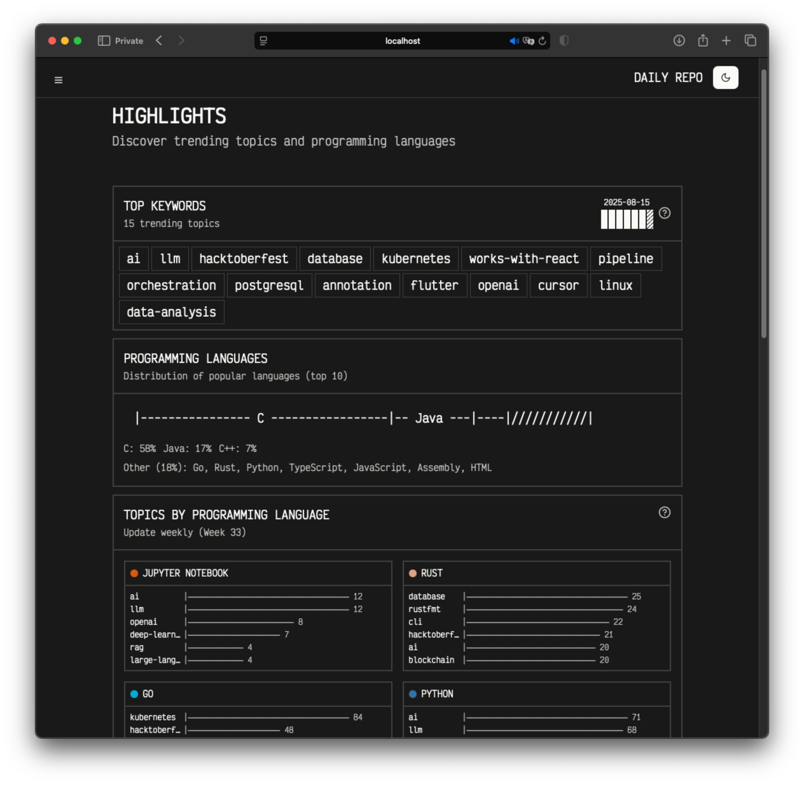

# DailyRepo


## Introduction

Track trending GitHub repositories with historical data analysis and interactive visualizations. Features keyword extraction, language analytics, and developer rankings across multiple categories.

---



## Features

### Repository Tracking

- Multi-category trending (linux-tool, cli, productivity, web-dev, ai-ml, security)
- Historical data collection and analysis
- Developer rankings by language and contributions
- Intelligent rate limiting with GitHub API integration

### Data Analytics

- Keyword extraction from trending repositories
- Language popularity analytics
- Topics categorized by programming language

## Development

```bash
pnpm install --frozen-lockfile
pnpm build
pnpm dev:api
pnpm dev:web
```

The API, frontend, GitHub scraper, and standalone analysis jobs are separate
workspaces under `apps/`; shared libraries live under `packages/`:

```text
apps/
  backend/     HTTP API
  frontend/    Web interface
  jobs/        Analysis commands and scheduler
  scraper/     Daily GitHub collection
packages/
  database/    Shared schemas and database utilities
```

See [data collection and analysis operations](OPERATIONS.md) for local job
commands, schedules, secrets, and historical backfill requirements.

## Documentation

1. [Documentation](docs/)
2. [API Versioning (v1 vs v2)](docs/versioning.md)
3. [Backend README](apps/backend/README.md)
4. [Frontend README](apps/frontend/README.md)
